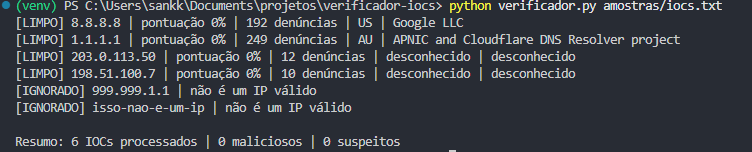

# Verificador de IOCs

Ferramenta em Python que consulta a reputação de IPs (indicadores de
comprometimento) na API do **AbuseIPDB** e classifica cada um como
LIMPO, SUSPEITO ou MALICIOSO.

Funciona em conjunto com o projeto
[analisador-logs](https://github.com/it-lucascoelho/analisador-logs):
o analisador detecta IPs que fizeram força bruta (MITRE ATT&CK T1110) e
este verificador enriquece esses IPs com dados de reputação, um fluxo
básico de triagem em SOC.

## Como funciona

1. Lê IPs de um `.txt` (um por linha) ou de um `.json` gerado pelo analisador-logs
2. Valida cada IP antes de consultar (evita gastar consultas e enviar entrada inválida)
3. Consulta o AbuseIPDB e trata erros de rede, chave inválida e limite excedido
4. Classifica pela pontuação de abuso e mostra um resumo
5. Exporta o resultado em JSON ou CSV (opcional)

## Instalação

```bash
git clone https://github.com/it-lucascoelho/verificador-iocs.git
cd verificador-iocs
python -m venv venv
# Windows: venv\Scripts\activate  |  Linux/Mac: source venv/bin/activate
pip install -r requirements.txt
```

## Configuração da chave de API

1. Crie uma conta gratuita em abuseipdb.com e gere uma chave em **Account > API**
2. Copie `.env.example` para `.env`
3. Coloque sua chave no `.env`:
   ```
   ABUSEIPDB_API_KEY=sua_chave_aqui
   ```

O `.env` está no `.gitignore` e nunca deve ser enviado ao GitHub.

## Uso

```bash
python verificador.py amostras/iocs.txt
python verificador.py amostras/suspeitos_exemplo.json --saida resultado.json
python verificador.py amostras/iocs.txt --saida resultado.csv
```

| Parâmetro | Descrição |
|---|---|
| `entrada` | arquivo `.txt` (um IP por linha) ou `.json` do analisador-logs |
| `--saida` | arquivo de saída (`.json` ou `.csv`) |

## Classificação

| Pontuação de abuso | Resultado |
|---|---|
| 0% a 24% | LIMPO |
| 25% a 74% | SUSPEITO |
| 75% a 100% | MALICIOSO |

Os limites são uma convenção minha para começar e ficam como constantes
no código (`LIMITE_SUSPEITO` e `LIMITE_MALICIOSO`).

A classificação usa a **pontuação de abuso**, não a quantidade de denúncias.
Nos testes, o `8.8.8.8` (DNS do Google) tinha 188 denúncias e pontuação 0%:
só o número de denúncias engana.

## Exemplo de saída



## Testes

```bash
python -m pytest -v
```

Os testes não chamam a API: a consulta é substituída por uma função falsa
(`monkeypatch`), então rodam rápido e sem credenciais.

## Sobre os dados de exemplo

Os IPs `203.0.113.x` e `198.51.100.x` são reservados para documentação
(RFC 5737) e não pertencem a ninguém. Servem só para testar o fluxo.

## Limitações e próximos passos

- Consulta só IPs (domínios, URLs e hashes ficam para depois)
- Usa uma única fonte (AbuseIPDB); o VirusTotal seria uma segunda opinião
- Consultas feitas uma a uma; o plano gratuito tem limite diário
- Ideias: cache de resultados, consulta de domínios e hashes via VirusTotal
